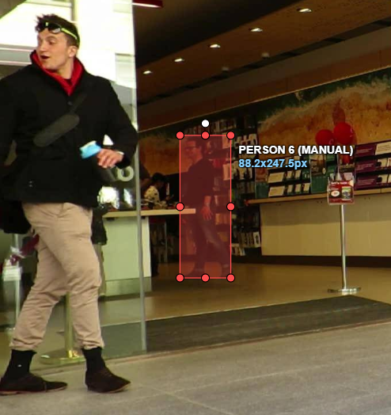
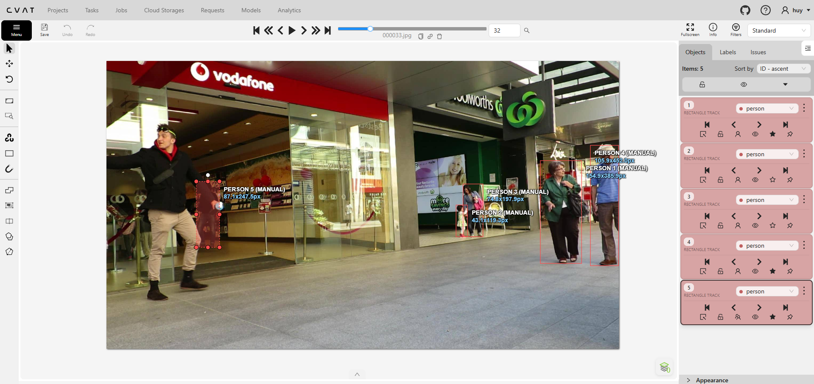
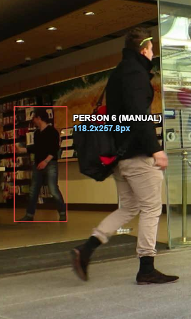

# Báo cáo cá nhân — Nguyễn Gia Huy — 2A202603215

**Lab Ngày 5: Gán track ID trên 150 frame bằng keyframe và nội suy.**

Dữ liệu: MOT17-09, 150 ảnh liên tiếp, độ phân giải 1920 × 1080, 30 fps. Nguồn: MOT17, MOTChallenge (Milan et al., 2016), giấy phép CC BY-NC-SA 3.0. Trong báo cáo, số frame được ghi theo CVAT, từ **0 đến 149**; trong `gt/gt.txt`, số frame tương ứng bằng frame CVAT + 1.

Trong bài thực hành, em thực hiện gán nhãn thủ công cho năm người được giao, xử lý che khuất, kiểm tra lại track ID và xuất nhãn theo hai định dạng yêu cầu. Các kết quả trong báo cáo được tổng hợp từ quá trình thực hiện, ảnh chụp màn hình và hai file nhãn xuất từ CVAT.

## 0. Thông tin sinh viên

- Họ tên: Nguyễn Gia Huy
- MSSV: 2A202603215
- Mã đề: **B**
- Email: 26ai.huyng@vinuni.edu.vn
- Repository: [K5-L2A-DAY05-NguyenGiaHuy-2A202603215-MOTTracking](https://github.com/VamosHuiJia/K5-L2A-DAY05-NguyenGiaHuy-2A202603215-MOTTracking)
- Task: [DAY05-MOT17-09-B-2A202603215 — Task 25](http://localhost:8080/tasks/25)
- Job: [Job 18](http://localhost:8080/tasks/25/jobs/18)
- Giờ bắt đầu: 16:20 (GMT+7).
- Giờ kết thúc: 18:40 (GMT+7).
- Tổng thời gian theo mốc bắt đầu và kết thúc: **140 phút**. Thời gian thực hiện từng người tại mục 2 được em ước lượng lại sau buổi thực hành.
- Công cụ: CVAT Community trên máy cá nhân; Rectangle ở chế độ Track, nhãn `person`; Python và `src/check_submission.py`.

Đề B gồm năm ID gốc MOT17 `[1, 19, 20, 21, 22]`, lần lượt tương ứng P1–P5. Mã người, ID trên giao diện và ID trong file xuất có thể khác nhau. Em đối chiếu từng người theo vị trí và tọa độ khung bao để xác định quan hệ giữa ID trong XML và MOT.

| Mã người | Nhận diện | ID gốc MOT17 | Track ID XML | Track ID MOT |
|---|---|---:|---:|---:|
| P1 | Người mặc đồ tối màu bên trong cửa hàng Vodafone | 1 | 4 | 4 |
| P2 | Người mặc áo khoác xanh lá, mang túi đen | 19 | 0 | 1 |
| P3 | Người mặc áo polo xanh lam sọc ngang, đội mũ sáng màu | 20 | 3 | 5 |
| P4 | Em nhỏ mặc đồ sáng màu trước cửa Woolworths | 21 | 1 | 2 |
| P5 | Người lớn mang túi hồng, đi cạnh P4 | 22 | 2 | 3 |

Hai ảnh trước và sau đoạn che được em chụp ở lần thực hiện ban đầu, khi P1 hiển thị là **PERSON 6**. Ảnh giữa đoạn che được chụp bổ sung ở frame 32 của job hiện tại, khi P1 hiển thị là **PERSON 5**. Em ghi rõ ID theo từng lần chụp để phân biệt với ID trong file xuất. Trong bản xuất mới, P1 được duy trì trên cùng XML track 4, tương ứng MOT track 4, trước và sau đoạn che.

## 1. Xem trước đoạn video (CP0)

Trước khi gán nhãn, em thiết lập Player step = 10, bật auto save, Show all interpolation tracks và Always show object details. Sau đó, em xem toàn bộ đoạn frame 0–149 bằng `V`/`C` để nhận diện năm người theo bảng đề B và quan sát các vị trí dễ xảy ra che khuất.

Em chưa ghi đầy đủ các mốc quan sát trước khi vẽ nên tổng hợp lại bảng dưới đây từ **nhãn đã xuất**. Vì vậy, cột frame đầu và cuối phản ánh phạm vi đã gán trong file, chưa phải kết quả kiểm chứng độc lập về thời điểm xuất hiện thực tế.

| Mã | Frame đầu có box trong file xuất | Frame cuối có box | Rẽ / dừng / đổi tốc độ hoặc kích thước | Bị che / cờ trong file xuất | Ghi chú |
|---|---:|---:|---|---|---|
| P1 | 0 | 149 | Keyframe tập trung quanh đoạn che 30–55; chưa ghi riêng mốc rẽ/dừng | 30–37 và 49–54: occluded; 38–48: outside | Người mặc đồ tối màu bên trong cửa hàng Vodafone |
| P2 | 0 | 149 | Kích thước box tăng khi tiến gần camera, rõ hơn ở đoạn 110–149 | Không có frame occluded/outside trong file xuất | Người mặc áo khoác xanh lá, mang túi đen |
| P3 | 3 | 149 | Box lớn dần; có thêm keyframe ở đoạn đầu và đoạn 119–130 | Không có occluded trong đoạn 3–149; frame 0–2 chưa có box hiện diện | Người mặc áo polo xanh lam sọc ngang, đội mũ sáng màu |
| P4 | 0 | 146 | Chưa ghi riêng mốc rẽ/dừng; các mốc cờ tập trung từ frame 106 | 106–109, 137–138, 144–146: occluded; 110–136 và từ 147: outside | Em nhỏ mặc đồ sáng màu trước cửa Woolworths |
| P5 | 0 | 104 | Chưa ghi riêng mốc rẽ/dừng; box đổi vị trí nhẹ trong đoạn đã gán | 100–104: occluded; từ 105: outside | Người lớn mang túi hồng, đi cạnh P4 |

**Điều chỉnh sau khi kiểm tra:** em đã bổ sung P5 tại frame 0–1 và mở rộng track P3 từ frame 40 về frame 3. Hai đoạn bổ sung tiếp tục sử dụng track cũ, không tạo thêm danh tính. Với P3 ở frame 0–2, đối tượng chỉ lộ một phần rất nhỏ tại mép phải; bản nộp hiện bắt đầu từ frame 3, và em chưa có quy ước riêng của lớp để xác nhận cách đặt khung cho phần nằm ngoài mép ảnh. Phạm vi đầu và cuối các track trong bảng phản ánh đúng bản xuất hiện tại.

## 2. Keyframe và thời gian (CP1, CP4)

Em thực hiện gán nhãn theo thứ tự P2 → P4 → P5 → P3 → P1. Với mỗi người, em tạo một rectangle track, chỉnh khung tại các mốc cách khoảng 10 frame, sau đó xem từng frame bằng `F`/`D` và bổ sung keyframe khi khung nội suy bị lệch. Khi người tiến gần camera, em tăng kích thước khung bao trên cùng track để giữ khung sát toàn thân.

Các số liệu dưới đây lấy từ `annotations.xml` bằng `src/check_submission.py`. “Frame có mặt” là số frame track có `outside = 0`, bao gồm cả các frame bị che một phần.

| Mã | Số keyframe | Keyframe ở frame | Số frame có mặt | Keyframe / 100 frame | Thời gian (phút) | Chỗ khó |
|---|---:|---|---:|---:|---|---|
| P1 | 47 | 0, 10, 17, 20, 26, 30, 31, 32, 33, 34, 35, 49, 50, 52, 53, 55, 60, 70, 73, 74, 75, 80, 90, 93, 94, 95, 97, 98, 99, 100, 102, 103, 104, 110, 112, 113, 118, 120, 122, 123, 125, 126, 127, 129, 130, 140, 149 | 139 | 33.8 | Khoảng 45 | Giữ box toàn thân khi bị che và nối lại cùng ID sau khi hiện lại |
| P2 | 65 | 0, 7, 8, 9, 10, 13, 17, 19, 20, 30, 31, 32, 33, 35, 38, 40, 41, 42, 43, 44, 45, 46, 47, 49, 50, 53, 54, 56, 60, 62, 66, 67, 70, 74, 77, 80, 81, 82, 90, 91, 92, 93, 96, 98, 100, 105, 107, 110, 116, 117, 118, 119, 120, 122, 123, 124, 125, 130, 131, 132, 133, 134, 140, 143, 149 | 150 | 43.3 | Khoảng 25 | Điều chỉnh đồng thời vị trí và kích thước khi người tiến gần camera |
| P3 | 31 | 3, 8, 17, 18, 20, 30, 31, 32, 33, 34, 40, 50, 60, 70, 80, 90, 100, 110, 119, 120, 121, 122, 123, 124, 125, 126, 127, 129, 130, 140, 149 | 147 | 21.1 | Khoảng 24 | Theo dõi người ở mép phải, điều chỉnh kích thước và bổ sung đoạn đầu từ frame 3 |
| P4 | 11 | 0, 10, 20, 30, 40, 50, 106, 137, 139, 140, 144 | 120 | 9.2 | Khoảng 17 | Người nhỏ, đi cạnh P5, cần tránh bao chung hai người và bỏ sót khi bị che |
| P5 | 45 | 0, 2, 10, 13, 15, 16, 17, 18, 19, 20, 24, 27, 28, 29, 30, 35, 37, 38, 39, 40, 41, 42, 44, 45, 46, 47, 48, 49, 50, 58, 62, 63, 67, 71, 73, 74, 78, 79, 81, 83, 85, 86, 89, 90, 100 | 105 | 42.9 | Khoảng 23–30 | Tách box khỏi P4 và bổ sung frame 0–1 vào cùng track |
| **Tổng** | **199** | — | **661** | **30.1** | **Khoảng 134–141 phút gán; thêm khoảng 10 phút review tổng thể** | — |

Keyframe / 100 frame của cả bài = 199 ÷ 661 × 100 ≈ **30,1 keyframe / 100 frame**.

**Ghi chú thời gian:** em ước lượng thời gian gán P2 khoảng 25 phút, P4 khoảng 17 phút, P5 khoảng 23–30 phút, P3 khoảng 24 phút và P1 khoảng 45 phút; thời gian kiểm tra tổng thể khoảng 10 phút. Tổng các khoảng ước lượng là 144–151 phút, chênh khoảng 4–11 phút so với thời lượng 140 phút theo mốc bắt đầu và kết thúc. Nguyên nhân là em không bấm giờ riêng cho từng người mà ước lượng lại sau khi hoàn thành. Các mốc giờ này thuộc lần thực hiện ban đầu; em chưa ghi riêng thời gian bổ sung P3 và P5 sau đó.

P2 có nhiều keyframe nhất: **65 keyframe**, tương ứng **43,3/100 frame**. Box của P2 cao khoảng 342,8 pixel ở frame 0 và 830,8 pixel ở frame 149, thể hiện sự thay đổi kích thước rõ khi tiến gần camera. Số keyframe cao phản ánh việc em đã điều chỉnh nhiều lần để khung bám sát người. Tuy nhiên, em nhận thấy cách đặt keyframe còn dày ở một số đoạn liên tiếp; ở lần thực hiện sau, em sẽ tập trung vào những mốc thay đổi chuyển động và kích thước rõ để giảm thao tác. Không track nào vượt ngưỡng cảnh báo 50 keyframe / 100 frame.

## 3. Đoạn bị che (CP2)

Người bị che: **P1**, người bên trong cửa hàng Vodafone. Người đi phía trước che P1 là người áo đen, quần sáng màu; đây không phải P2 (người áo xanh lá) của đề B.

Em đối chiếu các mốc xử lý che khuất với trạng thái cờ trong XML track 4:

| Mốc | Frame CVAT |
|---|---:|
| Bắt đầu bị che một phần, bật `occluded` | 30 |
| Mất hẳn, bật `outside` | 38 |
| Hiện lại, tắt `outside`; vẫn còn `occluded` | 49 |
| Thấy rõ trở lại, tắt `occluded` | 55 |

- Đoạn khuất hẳn theo file xuất: **frame 38–48**, gồm 49 − 38 = **11 frame**, tương đương 11/30 ≈ **0,37 giây**.
- Đoạn bị che một phần nhưng vẫn có box: frame **30–37** và **49–54**, tổng **14 frame**.
- Quyết định của em: **giữ cùng track, cùng ID** trước và sau đoạn che.
- Lý do: thời gian khuất 11 frame nhỏ hơn ngưỡng 60 frame của lớp; ảnh trước và sau cho thấy cùng người mặc đồ tối màu ở trong Vodafone, giữ hướng di chuyển trong khu vực cửa hàng. Những đặc điểm này hỗ trợ việc nối lại cùng danh tính thay vì tạo track mới.
- Khi P1 bị che một phần, em giữ khung bao toàn thân ước lượng. Khi P1 mất hẳn, em bật `outside` để tạm ngừng xuất box và giữ lại track để tiếp tục khi người xuất hiện trở lại.

Ảnh minh họa quá trình xử lý che khuất của P1:



*Trước đoạn che: P1 bên trong Vodafone, mang ID 6 trên giao diện.*



*Frame 32: P1 bị che một phần, khung ID 5 có nét đứt. Thẻ track số 5 trong panel Objects hiển thị cờ occluded; ô số frame phía trên xác định thời điểm chụp. Đây là ảnh bổ sung từ job hiện tại; các mốc outside được đối chiếu riêng trong file XML.*



*Sau đoạn che: P1 hiện lại, vẫn mang ID 6 trên giao diện.*

**Nguồn ảnh:** MOT17, MOTChallenge (Milan et al., 2016). Em chỉ sử dụng ảnh chụp vùng cần thiết trong quá trình gán nhãn.

## 4. Tự review ID (CP3)

Em đã kiểm tra đủ hai lượt: theo từng người từ cuối về đầu và theo toàn cảnh với bước nhảy 10 frame. Trong khi gán, sau mỗi mốc 10 frame em đã xem từng frame ở giữa, phát hiện box bị lệch và dùng chuột chỉnh lại ngay. Sau khi hoàn thành năm người, em dành thêm khoảng 10 phút để kiểm tra tổng thể.

Trong quá trình thực hiện, em ghi nhận lỗi **`drift`**, tức là khung nội suy chưa bám sát vị trí hoặc kích thước người giữa các keyframe. Em sửa bằng cách điều chỉnh khung tại frame bị lệch và bổ sung keyframe. Khi kiểm tra lại sau lần xuất đầu, em còn phát hiện hai đoạn thiếu box và bổ sung nhãn cho P5 ở frame 0–1, P3 ở frame 3–39. Bảng dưới ghi riêng hai đoạn này và tổng hợp các lần sửa drift theo từng người. Với drift đã sửa ngay trong lúc gán, em chưa ghi riêng số frame, số lần phát hiện và lượt kiểm tra của từng lỗi; vì vậy, nhật ký chưa phản ánh đầy đủ từng lần chỉnh sửa.

| Frame | Mã người | Loại lỗi | Mô tả một câu | Phát hiện ở lượt | Đã sửa? |
|---|---|---|---|---|---|
| 0–1 | P5 | `lost` | Người đã nhìn thấy nhưng bản xuất đầu chưa có box; em tắt outside và bổ sung box vào cùng track | Kiểm tra bổ sung sau lần xuất đầu | Có; bản xuất mới có box từ frame 0 |
| 3–39 | P3 | `lost` | Bản xuất đầu bắt đầu từ frame 40; em bổ sung đoạn đầu từ frame 3 vào cùng track | Kiểm tra bổ sung sau lần xuất đầu | Có; bản xuất mới có box từ frame 3 |
| Các frame giữa hai mốc cách 10; chưa ghi số cụ thể | P1 | `drift` | Chỉnh lại box bị lệch khi xem từng frame, giữ box theo đúng người bên trong Vodafone | Trong lúc gán; đã kiểm lại hai lượt, chưa ghi lượt riêng cho từng lỗi | Có, chỉnh box và bổ sung keyframe |
| Các frame giữa hai mốc cách 10; chưa ghi số cụ thể | P2 | `drift` | Chỉnh vị trí và kích thước box khi người áo xanh lá di chuyển, tiến gần camera | Trong lúc gán; đã kiểm lại hai lượt, chưa ghi lượt riêng cho từng lỗi | Có, chỉnh box và bổ sung keyframe |
| Các frame giữa hai mốc cách 10; chưa ghi số cụ thể | P3 | `drift` | Chỉnh lại box của người áo xanh lam khi nội suy không bao sát người | Trong lúc gán; đã kiểm lại hai lượt, chưa ghi lượt riêng cho từng lỗi | Có, chỉnh box và bổ sung keyframe |
| Các frame giữa hai mốc cách 10; chưa ghi số cụ thể | P4 | `drift` | Chỉnh box em nhỏ tại các frame nằm giữa những mốc đã gán | Trong lúc gán; đã kiểm lại hai lượt, chưa ghi lượt riêng cho từng lỗi | Có, chỉnh box và bổ sung keyframe |
| Các frame giữa hai mốc cách 10; chưa ghi số cụ thể | P5 | `drift` | Chỉnh box người mang túi hồng để bám đúng người khi xem từng frame | Trong lúc gán; đã kiểm lại hai lượt, chưa ghi lượt riêng cho từng lỗi | Có, chỉnh box và bổ sung keyframe |

Tổng hợp theo loại lỗi:

| `id_switch` | `fragmentation` | `lost` | `merge` | `false_track` | `drift` | `flag` |
|---|---|---|---|---|---|---|
| Chưa ghi nhận riêng | Chưa ghi nhận riêng | Đã sửa 2 đoạn thiếu box: P5 0–1 và P3 3–39 | Chưa ghi nhận riêng | Chưa ghi nhận riêng | Có sửa trên cả 5 người; chưa đếm số lần | Chưa thống kê riêng |

Em ghi nhận hai đoạn thiếu box được sửa trong lần kiểm tra bổ sung. Với drift, em chưa thống kê số lần nên không quy đổi năm dòng tổng hợp thành năm lần lỗi và không kết luận các loại chưa thống kê có số lỗi bằng 0. Việc chưa ghi nhật ký ngay tại thời điểm sửa là một hạn chế trong cách thực hiện bài.

**Nhận xét về hai lượt kiểm tra:** em chưa ghi nhận riêng trường hợp lỗi chỉ được phát hiện ở lượt 2. Lượt kiểm tra theo người giúp em tập trung vào độ bám của khung và tính liên tục của ID, còn lượt xem toàn cảnh giúp kiểm tra đồng thời năm đối tượng để tìm khung trùng hoặc thiếu.

## 5. File xuất và kết quả tự kiểm (CP4)

| Kiểm tra | Kết quả |
|---|---|
| File MOT 1.1 | `src/exports/NguyenGiaHuy_mot.zip` |
| File CVAT for video 1.1 | `src/exports/NguyenGiaHuy_cvat_video.zip` |
| Số track ID khác nhau trong `gt/gt.txt` | **5** |
| Tổng số box MOT | **661** |
| Hai ZIP có kèm ảnh không? | **Không**; MOT chỉ chứa `gt/labels.txt`, `gt/gt.txt`; CVAT chỉ chứa `annotations.xml` |
| Frame outside không có dòng trong MOT | **Đúng**; MOT track 4 (P1) không có dòng ở frame CVAT 38–48, tức MOT frame 39–49 |
| Giữ cùng ID qua đoạn che của P1 | **Có** trong hai file xuất đã đối chiếu |
| Trạng thái job completed | Em đã chuyển Job 18 sang **completed** trên CVAT |
| Kết quả tự kiểm | **0 lỗi, 0 cảnh báo** |

Em chạy script tự kiểm từ thư mục gốc repository bằng lệnh:

```powershell
.\.venv\Scripts\python.exe -X utf8 src/check_submission.py --mot src/exports/NguyenGiaHuy_mot.zip --cvat src/exports/NguyenGiaHuy_cvat_video.zip
```

Kết quả kiểm tra hai file xuất:

```text
Số frame in theo CVAT (bắt đầu từ 0). Trong gt.txt, frame_id = frame CVAT + 1.

=== File MOT 1.1: NguyenGiaHuy_mot.zip ===
  Số track ID: 5   |   Tổng số box: 661
  [OK]        Đúng 5 track ID.

  Track | Frame có mặt | Số frame | Đoạn vắng (outside)
      1 |   0–149      |      150 | -
      2 |   0–146      |      120 | 110–136
      3 |   0–104      |      105 | -
      4 |   0–149      |      139 | 38–48
      5 |   3–149      |      147 | -


=== File CVAT for video 1.1: NguyenGiaHuy_cvat_video.zip ===

  Track | Nhãn   | Frame thấy | Keyframe | KF/100 frame | Frame occluded | Lần bật outside
      0 | person |        150 |       65 |         43.3 |              0 |               0
              Track 0: keyframe ở frame [0, 7, 8, 9, 10, 13, 17, 19, 20, 30, 31, 32, 33, 35, 38, 40, 41, 42, 43, 44, 45, 46, 47, 49, 50, 53, 54, 56, 60, 62, 66, 67, 70, 74, 77, 80, 81, 82, 90, 91, 92, 93, 96, 98, 100, 105, 107, 110, 116, 117, 118, 119, 120, 122, 123, 124, 125, 130, 131, 132, 133, 134, 140, 143, 149]
      1 | person |        120 |       11 |          9.2 |              9 |               2
              Track 1: keyframe ở frame [0, 10, 20, 30, 40, 50, 106, 137, 139, 140, 144]
      2 | person |        105 |       45 |         42.9 |              5 |               1
              Track 2: keyframe ở frame [0, 2, 10, 13, 15, 16, 17, 18, 19, 20, 24, 27, 28, 29, 30, 35, 37, 38, 39, 40, 41, 42, 44, 45, 46, 47, 48, 49, 50, 58, 62, 63, 67, 71, 73, 74, 78, 79, 81, 83, 85, 86, 89, 90, 100]
      3 | person |        147 |       31 |         21.1 |              0 |               0
              Track 3: keyframe ở frame [3, 8, 17, 18, 20, 30, 31, 32, 33, 34, 40, 50, 60, 70, 80, 90, 100, 110, 119, 120, 121, 122, 123, 124, 125, 126, 127, 129, 130, 140, 149]
      4 | person |        139 |       47 |         33.8 |             14 |               1
              Track 4: keyframe ở frame [0, 10, 17, 20, 26, 30, 31, 32, 33, 34, 35, 49, 50, 52, 53, 55, 60, 70, 73, 74, 75, 80, 90, 93, 94, 95, 97, 98, 99, 100, 102, 103, 104, 110, 112, 113, 118, 120, 122, 123, 125, 126, 127, 129, 130, 140, 149]

  Tổng: 199 keyframe / 661 frame có mặt = 30.1 keyframe / 100 frame
  [OK]        Đọc được 5 track từ annotations.xml.

=== Tóm tắt ===
  Lỗi: 0   |   Cảnh báo: 0
  Đạt. Dán phần tóm tắt này vào báo cáo mục 5.
```

Kết quả tự kiểm cho thấy hai file xuất đọc được, có đúng năm track và không có lỗi hoặc cảnh báo theo các điều kiện của script. Do script không sử dụng ground truth và không tính MOTA/IDF1, em chỉ dùng kết quả này để kiểm tra cấu trúc và các dấu hiệu bất thường; chất lượng bám người và tính đúng đắn của ID vẫn được xem xét bằng hai lượt kiểm tra thủ công.

Trong quá trình thực hiện, em gặp một số khó khăn và xử lý như sau:

- Ban đầu em dùng đường dẫn `.venv/bin/python` trong Windows PowerShell nên không chạy được script. Em khắc phục bằng cách sử dụng `.\.venv\Scripts\python.exe`.
- CVAT server 2.74.1 hiển thị cảnh báo không tương thích hoàn toàn với SDK 2.82.0. Em vẫn tạo được Task 25 / Job 18, gán nhãn và xuất hai file đọc được bằng script tự kiểm. Em chưa nâng cấp server trong buổi thực hành.
- Ban đầu em chưa phân biệt rõ nội suy với nhận diện tự động. Sau khi thực hành, em hiểu rằng CVAT tính vị trí và kích thước khung giữa các keyframe; em vẫn phải kiểm tra từng frame và chỉnh bằng tay khi khung bị lệch.
- Em nhận thấy frame tham chiếu trong bảng P1–P5 chỉ giúp nhận diện đối tượng, không thay thế việc quan sát để xác định frame xuất hiện đầu tiên.

## 6. Ba câu kết

1. **Nếu được gán lại, bạn sẽ đặt keyframe khác ở đâu? Vì sao?**

   Nếu gán lại, em sẽ chú ý hơn ở đoạn P1 bắt đầu bị che khoảng frame 30, hiện lại ở frame 49 và thấy rõ trở lại ở frame 55. Đây là những chỗ khung dễ bị lệch nên cần chỉnh kỹ và kiểm tra các frame ở giữa. Với P2, em sẽ điều chỉnh kích thước khung khi người tiến gần camera, đồng thời giảm những keyframe quá gần nhau nếu khung vẫn bám đúng. Em sẽ dựa vào chuyển động thực tế để đặt keyframe, thay vì cứ cách 10 frame là chỉnh một lần.

2. **Có chỗ nào bạn không chắc “cùng ID hay ID mới”? Bạn đã quyết định và ghi chú thế nào?**

   Trường hợp cần cân nhắc là P1 bị che hoàn toàn ở frame 38–48. Em giữ ID cũ vì người chỉ khuất 11 frame, khoảng 0,37 giây, ngắn hơn ngưỡng 2 giây của lớp. Khi người xuất hiện lại, em đối chiếu quần áo, vị trí và hướng di chuyển để xác định vẫn là người trước đó. Em bật `outside` ở frame 38, tắt ở frame 49 và chỉnh lại khung trên cùng track. Các mốc này và ảnh trước, trong, sau đoạn che được ghi ở mục 3 để thể hiện cách xử lý.

3. **Một lỗi ID trong job có thể làm xe tự lái dự đoán sai chuyển động như thế nào? Lỗi đó ảnh hưởng MOTA hay IDF1 nhiều hơn?**

   Trong job này, em chủ yếu sửa lỗi lệch khung và chưa ghi nhận một lỗi đổi ID cụ thể. Nếu một ID chuyển nhầm sang người khác, hệ thống có thể ghép vị trí của hai người thành một quỹ đạo, từ đó tính sai tốc độ và hướng di chuyển. Xe tự lái có thể dự đoán sai vị trí người sẽ đi tới và đưa ra quyết định tránh va chạm không phù hợp. Lỗi giữ sai danh tính kéo dài thường ảnh hưởng IDF1 rõ hơn vì chỉ số này đánh giá sự nhất quán của ID trên toàn đoạn. MOTA cũng giảm khi có lỗi đổi ID, nhưng còn tính cả người bị bỏ sót và box thừa nên không phản ánh riêng chất lượng giữ ID.

## Bonus (nếu làm)

Bài nộp hiện tại tập trung vào năm người được giao và chưa có kết quả thực hiện các nội dung bonus B1, B2, B3.

## 7. Tài liệu tham khảo và công cụ AI đã dùng

- MOT17, MOTChallenge (Milan et al., 2016), dữ liệu MOT17-09; giấy phép CC BY-NC-SA 3.0.
- [Quy định bài lab](../../RULES.md).
- [Quy ước gán nhãn tracking](../../docs/GUIDELINE.md).
- [Các checkpoint CP0–CP4](../../CHECKPOINTS.md).
- [Bảng tra nhanh CVAT](../../docs/CVAT_CHEATSHEET.md).
- [Định dạng MOT và MOTA/IDF1](../../docs/MOT_FORMAT.md).
- [Yêu cầu nộp bài](../../SUBMISSION.md).
- [Script tự kiểm](../../src/check_submission.py) và hai file nhãn em xuất từ CVAT.
- Em sử dụng ChatGPT/Codex để tìm hiểu thao tác CVAT, nội suy, điều chỉnh kích thước khung, cờ `occluded`/`outside` và cách xử lý lỗi cài đặt; đồng thời hỗ trợ đối chiếu thống kê XML/MOT và biên tập bản nháp báo cáo. Em thực hiện gán khung, duy trì track ID, chỉnh sửa và kiểm tra nhãn thủ công; không sử dụng AI để sinh box hoặc track ID. Thời gian ước lượng và nội dung mô tả quá trình thực hiện được tổng hợp từ trải nghiệm của em.
